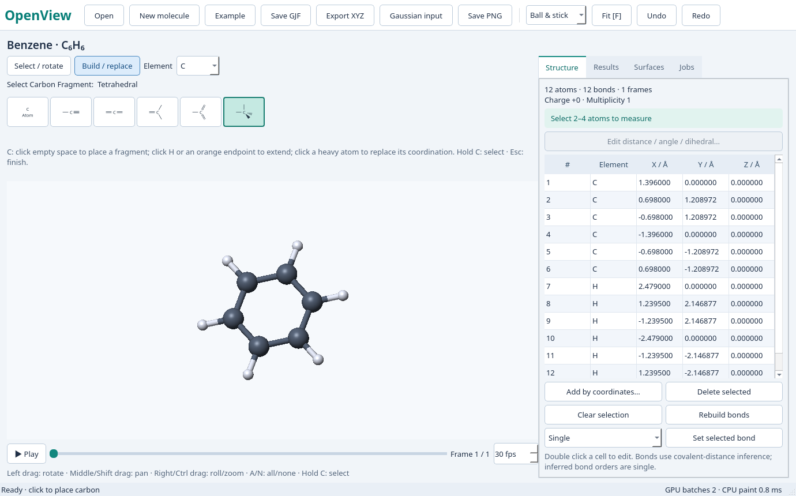

# OpenView

面向 Linux 桌面的独立分子工作台，使用 Python、Qt 6 和 OpenGL。目标是提供直观的分子显示与编辑，并逐步对齐 GaussView 的操作习惯。原项目名为 GV Next，当前版本为 **0.3.0**，尚未完整复刻 GaussView。



## 安装和运行

需要 [uv](https://docs.astral.sh/uv/)、图形桌面及支持 OpenGL 3.3 的驱动。Python 和依赖由项目内 `.venv` 管理，不需要修改系统 Python。

```sh
git clone https://github.com/Tiny-Cube/openview.git
cd openview
sh install.sh
sh run.sh
sh run.sh examples/water.gjf
```

也可以直接使用 uv：

```sh
uv sync --frozen
uv run --no-sync openview examples/water.xyz
uv run --no-sync python -m openview --version
```

Ubuntu/Debian 若缺少 Qt 图形依赖，可安装：

```sh
sudo apt install libegl1 libgl1 libxcb-cursor0 libxkbcommon-x11-0
```

Wayland 插件存在兼容问题时可尝试 `QT_QPA_PLATFORM=xcb sh run.sh`。诊断软件渲染时可设置 `LIBGL_ALWAYS_SOFTWARE=1`；软件渲染性能与硬件加速结果需分别判断。

## 当前功能

- 球棍、棒状和空间填充显示；旋转、平移、缩放、选择及距离/键角/二面角测量。
- 添加或删除原子、修改元素和键级、元素构型 Fragment、键长/键角/二面角预览编辑、撤销与重做。
- GJF 导出及显式连接保留，XYZ 导出、PNG 截图、能量和 IR 数据导出。
- 多帧轨迹与振动播放，已有 CUBE 数据的等值面显示。
- 文件解析、成键和等值面处理在独立工作进程中执行。

| 文件格式 | 支持范围 |
| --- | --- |
| GJF / COM | Cartesian、Z-matrix、单位、电荷/多重度及显式连接；首个 Link1 作业 |
| Gaussian LOG / OUT | Standard/Input orientation、多帧、SCF 能量及标准谐振动块 |
| FCHK / FCH | 结构、Bohr→Å、连接/键级、电荷/多重度、能量及已支持的振动字段 |
| CHK | 已识别的64-bit directory / 997 / -12349 / 20布局；未知布局可使用另装的 formchk |
| XYZ、PDB、MOL/SDF、CUBE | 具体边界见[使用说明](docs/USAGE.zh-CN.md) |

未知 CHK 布局可指定转换工具：

```sh
OPENVIEW_FORMCHK=/path/to/formchk sh run.sh molecule.chk
```

兼容旧环境变量 `GVNEXT_FORMCHK`，优先使用 `OPENVIEW_FORMCHK`。程序不会用旁边的同名 FCHK 冒充成功解析 CHK。不支持将编辑结果写回 LOG 或二进制 CHK。

## 操作

左键拖动旋转；中键或 Shift+左键平移；右键或 Ctrl+左键水平拖动滚转、垂直拖动缩放；滚轮缩放。选择原子后，可设置键级或编辑几何。选择元素及 Fragment 后，在空白处放置，或点击已有原子进行替换/拼接。`Ctrl+Z` 撤销，`Ctrl+Shift+Z` 重做，`Ctrl+S` 预览并保存 GJF。

完整 Clean、全部 SmartSlide 策略、所有结果分析与原版快捷键仍未实现。当前 `F` 用于适配视图，与原版片段扩展选择存在差异。编辑结构会清除失效的计算结果，避免将旧数据套到新几何上。详见[使用说明与限制](docs/USAGE.zh-CN.md)。

## 开发与验证

```sh
uv sync --frozen --extra dev
uv run --no-sync pytest -q
uv run --no-sync python tools/check_interaction.py
uv run --no-sync python tools/check_features.py
uv run --no-sync python tools/check_element_palette.py --out validation/elements
uv build
uv run --no-sync python tools/verify_distribution.py
```

无显示器时，可在 Python 命令前使用 `xvfb-run -a` 并设置 `QT_QPA_PLATFORM=xcb LIBGL_ALWAYS_SOFTWARE=1`。Linux CI 已配置，具体远程结果以 GitHub Actions 为准。[验证记录](docs/VALIDATION.zh-CN.md)区分历史 Linux 实测、本次改名验证和待完成项目，不保证所有输入与硬件都无卡顿。

仓库只收纳独立应用源码、测试和示例；原版安装包、商业计算程序、密钥、用户计算文件、虚拟环境和大型逆向捕获不随仓库分发。[研究状态](docs/RESEARCH.zh-CN.md)记录 REA 调查范围与未完成项。

## 许可

独立应用源码采用 [MIT](LICENSE) 许可。GaussView、Gaussian、[REA](https://github.com/morluto/rea)及所用依赖是各自独立的项目。本项目不包含 Gaussian 计算引擎，也不是其官方产品。

维护者：Tiny-Cube · 1620836684@qq.com
